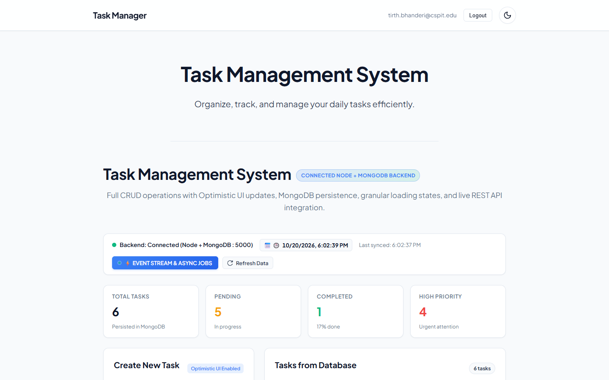
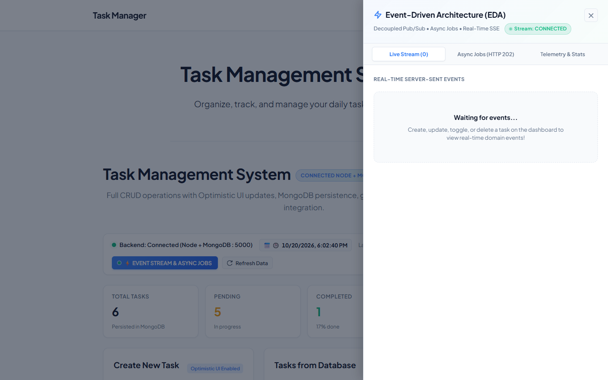
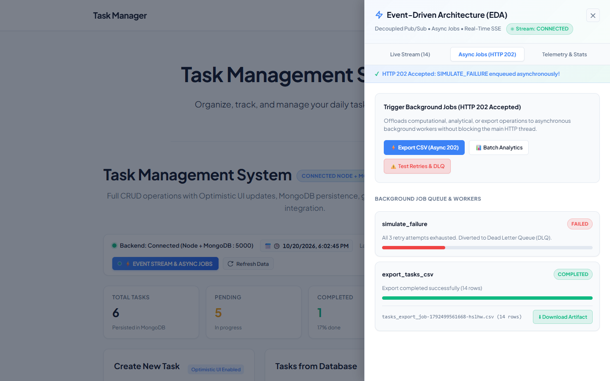
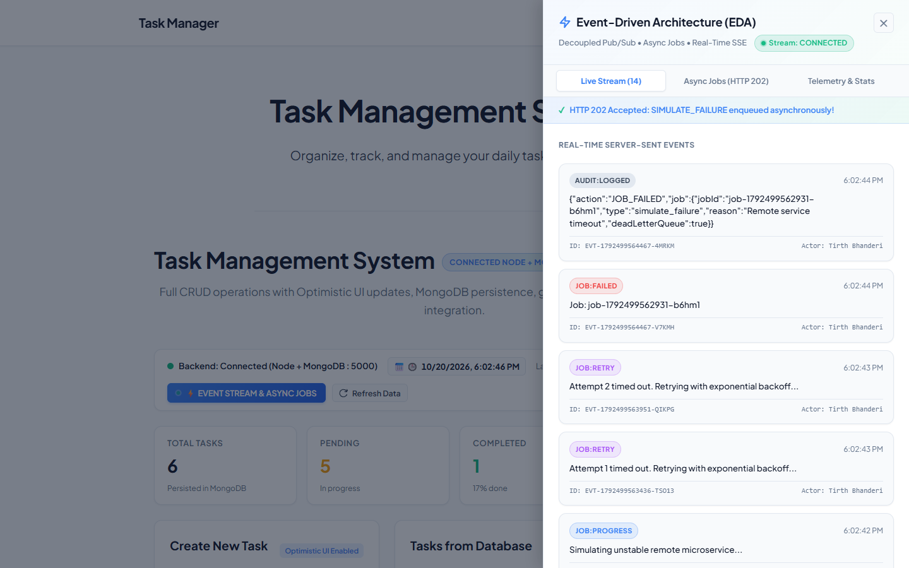
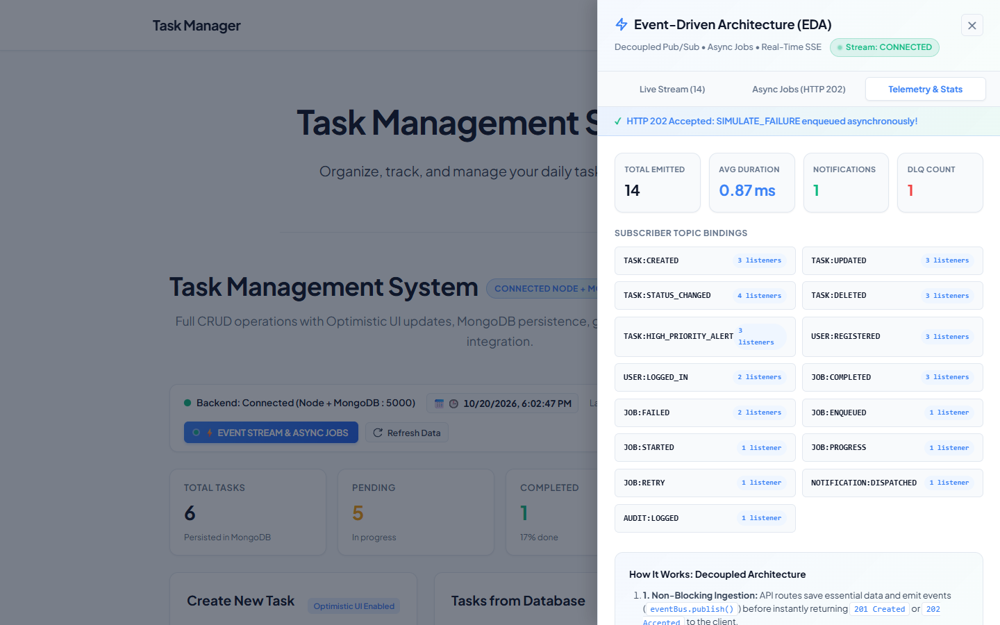
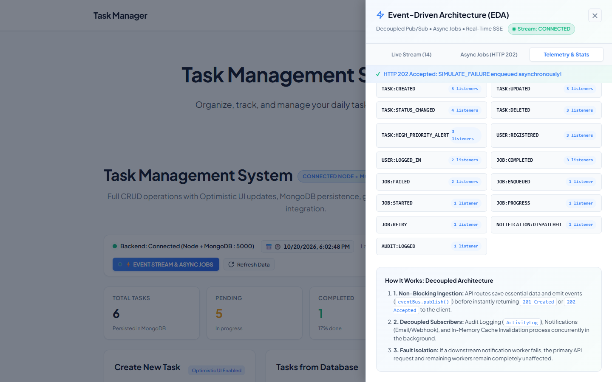

# assignment-w4-D25AIML081

## Task Management REST API — Portfolio Project

**Student:** Tirth Bhanderi  
**Enrollment:** D25AIML081

### Overview

A full-stack Task Management application built with React (Vite) frontend and Express.js backend, demonstrating REST API design at Richardson Maturity Model Level 3 (HATEOAS).

### Tech Stack

- **Frontend:** React 19, React Router, Vite
- **Backend:** Node.js, Express 5
- **Styling:** Vanilla CSS with dark mode support

### Features

- Full CRUD operations on tasks (Create, Read, Update, Delete)
- HATEOAS hypermedia links in every API response
- Discoverable API entry point (`GET /api`)
- Request logging to CSV
- Global error handling middleware
- CORS enabled for cross-origin requests
- Dark/Light theme toggle
- API Explorer page for interactive testing

### Running Locally

```bash
# Install dependencies
npm install

# Start the backend server (port 5000)
npm run server

# Start the frontend dev server
npm run dev
```

---

## Containerization with Docker & Docker Compose

The whole stack (database, API, web UI) ships as three containers orchestrated by
Docker Compose. Nothing needs to be installed on the host beyond Docker.

### Architecture

```
                    ┌──────────────────────────────┐
   Browser  ──────► │  frontend  (nginx:1.27)      │  :8080 → :80
                    │  • serves the built Vite SPA │
                    │  • SPA history fallback      │
                    │  • reverse-proxies /api/*    │
                    └───────────────┬──────────────┘
                                    │  /api/*  (incl. SSE)
                    ┌───────────────▼──────────────┐
                    │  backend   (node:22-alpine)  │  :5000 → :5000
                    │  • Express 5 REST API        │
                    │  • JWT auth, cache, EDA/SSE  │
                    │  • runs as the non-root       │
                    │    "node" user                │
                    └───────────────┬──────────────┘
                                    │  mongodb://mongo:27017/task-manager
                    ┌───────────────▼──────────────┐
                    │  mongo     (mongo:7)         │
                    │  • persistent volume         │
                    │    "mongo-data"              │
                    └──────────────────────────────┘
```

The frontend is built with `VITE_API_URL=/`, so the browser only ever talks to the
**same origin** (`/api/...`). nginx forwards those calls to the backend container,
which keeps the internal hostnames/ports out of the client bundle and removes any
CORS dependency.

### Files added

| Path | Purpose |
|---|---|
| `docker-compose.yml` | Orchestrates `mongo`, `backend` and `frontend` |
| `backend/Dockerfile` | Multi-stage build → slim `node:22-alpine` runtime |
| `frontend/Dockerfile` | Vite build stage → `nginx:1.27-alpine` runtime |
| `docker/nginx.conf` | SPA hosting, gzip, `/api` reverse proxy, SSE support |
| `docker/smoke-test.sh` | End-to-end smoke test against the running stack |
| `docker/fix-container-networking.sh` | Helper for nested-Docker hosts (see Troubleshooting) |
| `.dockerignore` | Keeps the build context small and secrets out of images |

### Quick start

```bash
# 1. (optional) copy and tune the environment file
cp .env.example .env

# 2. Build the images and start the stack in the background
docker compose up -d --build

# 3. Check that everything is up and healthy
docker compose ps

# 4. Open the application
#    http://localhost:8080
```

| Service | Container URL | Host URL |
|---|---|---|
| Web UI (nginx) | `http://frontend:80` | http://localhost:8080 |
| REST API | `http://backend:5000` | http://localhost:5000 |
| MongoDB | `mongodb://mongo:27017/task-manager` | not published (internal only) |

### Configuration

All variables are optional — Compose falls back to sensible defaults.

| Variable | Default | Purpose |
|---|---|---|
| `FRONTEND_PORT` | `8080` | Host port for the nginx-served SPA |
| `BACKEND_PORT` | `5000` | Host port for the Express API |
| `JWT_SECRET` | dev placeholder | JWT signing secret — **always override in production** |
| `VITE_API_URL` (build arg) | `/` | Same-origin relative API calls through nginx |

### Useful commands

```bash
docker compose ps                 # status + health of every service
docker compose logs -f backend    # tail the API logs
docker compose exec backend sh    # shell inside the API container
docker compose restart backend    # restart just the API
docker compose down               # stop the stack (data volumes are kept)
docker compose down -v            # stop the stack and delete the volumes

./docker/smoke-test.sh            # end-to-end smoke test (17 checks)
```

### Data persistence

Two named volumes are used:

- `mongo-data` → `/data/db` inside the MongoDB container (tasks & users survive restarts)
- `backend-logs` → `/app/backend/logs` (CSV request log + EDA CSV exports)

### Health checks & startup ordering

Every image defines a `HEALTHCHECK`, and Compose uses `depends_on: condition:
service_healthy`, so the start order is guaranteed:

`mongo (healthy)` → `backend (healthy)` → `frontend`

The backend's health check uses Node's built-in `fetch`, so no extra packages
(`curl`/`wget`) have to be installed in the image.

### Troubleshooting

**Container-to-container connections time out** (backend logs
`MongoDB connection error: MongooseServerSelectionError`, or nginx returns
`504 Gateway Time-out`). This happens on nested-Docker / Docker-in-Docker hosts
where `br_netfilter` filters same-bridge traffic. Fix it once per host:

```bash
sudo ./docker/fix-container-networking.sh
docker compose restart backend
```

**Start from a clean slate** (also drops the database):

```bash
docker compose down -v && docker compose up -d --build
```

**Inspect the running stack:**

```bash
docker compose exec mongo mongosh --eval "db.getSiblingDB('task-manager').tasks.countDocuments()"
```

### API Endpoints

| Method | Endpoint | Description |
|--------|----------|-------------|
| GET | `/api` | API root — discoverable entry point |
| GET | `/api/tasks` | List all tasks |
| GET | `/api/tasks/:id` | Get a single task |
| POST | `/api/tasks` | Create a new task |
| PUT | `/api/tasks/:id` | Full update a task |
| PATCH | `/api/tasks/:id` | Partial update a task |
| DELETE | `/api/tasks/:id` | Delete a task |

### REST Maturity

See [MATURITY.md](MATURITY.md) for the full Richardson Maturity Model evaluation with HATEOAS examples.

---

### Practical 8: Performance Optimization & Route-Based Lazy Loading

Implemented route-level code splitting using `React.lazy()` and `React.Suspense` with an accessible, theme-aware skeleton fallback UI (`RouteLoadingFallback.jsx`).

#### Performance Comparison Table

| Metric | Before Optimization (Monolithic Bundle) | After Optimization (Code Splitting) | Delta / Improvement |
|---|---|---|---|
| **Initial Main JS Bundle** | `index-L01qC0o1.js` (301.32 kB) | `index-BDd0WrT7.js` (239.86 kB) | **-61.46 kB (-20.4%)** |
| **Gzip Compressed Size** | 92.57 kB | 76.67 kB | **-15.90 kB (-17.2%)** |
| **Vite Build Time** | 2.17s | 1.02s | **53.0% faster** |
| **Bundle Architecture** | 1 monolithic bundle (all routes upfront) | 9 discrete asynchronous chunks | Route chunks loaded on demand |

#### Visual Evidence

##### 1. Chrome DevTools Network Tab (Slow 3G Profiling & Route Chunks)


##### 2. Vite Build Comparison (Monolithic Bundle vs Code Splitting)


##### 3. Slow 3G Suspense Fallback UI (Spinner + Skeleton Shimmer)


- **Detailed Academic Report & Viva Questions:** See [docs/PRACTICAL_8_REPORT.md](docs/PRACTICAL_8_REPORT.md)
- **All Screenshots:** View complete image set in [docs/screenshots/](docs/screenshots/)
- **Automated Profiling Suite:** `node scripts/measure_practical8_metrics.js`
- **Raw Metrics Data:** [docs/metrics_practical8.json](docs/metrics_practical8.json)

---

### Practical 9: Server-Side In-Memory Caching with `node-cache`

Implemented in-memory server-side caching using `node-cache` (60s TTL) for `GET /api/tasks`, combined with automated cache invalidation on write operations (`POST`, `PUT`, `DELETE`) to ensure strict read-after-write data correctness.

#### Empirical Response Time Comparison Table

| Request Condition | Sample 1 | Sample 2 | Sample 3 | Average Latency | Cache Header | Speedup / Reduction |
|---|:---:|:---:|:---:|:---:|:---:|:---:|
| **Uncached (MongoDB Query)** | 16.25 ms | 13.79 ms | 13.85 ms | **14.63 ms** | `X-Cache: MISS` | Baseline |
| **Cached (`node-cache` RAM)** | 6.38 ms | 8.35 ms | 7.76 ms | **7.50 ms** | `X-Cache: HIT` | **48.7% faster (2.0x)** |

#### Visual Evidence

##### 1. Postman Response Time Comparison (Uncached vs. Cached)


##### 2. Cache Invalidation and Coherence Flow


- **Detailed Academic Report & Viva Questions:** See [docs/PRACTICAL_9_REPORT.md](docs/PRACTICAL_9_REPORT.md)
- **Raw Benchmark Metrics Data:** [docs/metrics_practical9.json](docs/metrics_practical9.json)
- **Automated Benchmark Suite:** `node scripts/measure_practical9_caching.js`

---

### Practical 10: Asynchronous Processing with Event-Driven Architecture (EDA)

Implemented a decoupled in-process Pub/Sub Event Bus (`EventEmitter`), real-time unidirectional streaming via Server-Sent Events (SSE), and non-blocking background worker queues returning `HTTP 202 Accepted` with retry backoff and Dead Letter Queue (DLQ) fault isolation.

#### Visual Evidence (Portfolio Theme)

##### 1. Tasks Page with Live Clock & EDA Action Button


##### 2. Event-Driven Architecture Drawer (SSE Connected)


##### 3. Async Jobs Tab (HTTP 202 Accepted, CSV Export & DLQ Failure)


##### 4. Live Stream Tab (Real-Time Domain Events)


##### 5. Telemetry & Stats (Quad Metrics & Subscriber Topic Bindings)


##### 6. Telemetry Scrolled View (Architecture Notes & Fault Isolation)


- **Detailed Academic Report & Viva Questions:** See [docs/PRACTICAL_10_REPORT.md](docs/PRACTICAL_10_REPORT.md)
- **Automated Suite & Screenshot Runner:** `node scripts/capture_practical10_eda_screenshots.js`