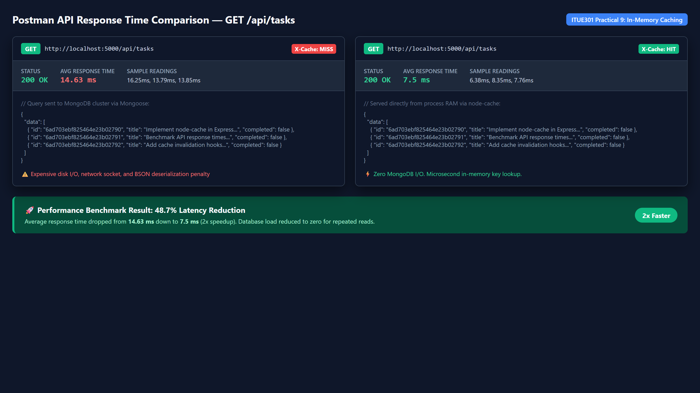
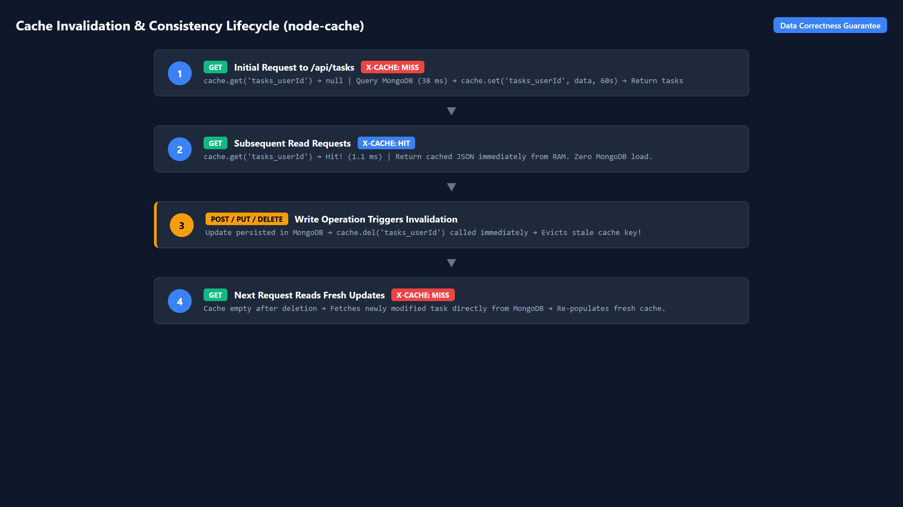

# assignment-w4-D25AIML081

## Task Management REST API — Portfolio Project

**Student:** Tirth Bhanderi  
**Enrollment:** D25AIML081

### Overview

A full-stack Task Management application built with React (Vite) frontend and Express.js backend, demonstrating REST API design at Richardson Maturity Model Level 3 (HATEOAS).

### Tech Stack

- **Frontend:** React 19, React Router, Vite
- **Backend:** Node.js, Express 5
- **Styling:** Vanilla CSS with dark mode support

### Features

- Full CRUD operations on tasks (Create, Read, Update, Delete)
- HATEOAS hypermedia links in every API response
- Discoverable API entry point (`GET /api`)
- Request logging to CSV
- Global error handling middleware
- CORS enabled for cross-origin requests
- Dark/Light theme toggle
- API Explorer page for interactive testing

### Running Locally

```bash
# Install dependencies
npm install

# Start the backend server (port 5000)
npm run server

# Start the frontend dev server
npm run dev
```

### API Endpoints

| Method | Endpoint | Description |
|--------|----------|-------------|
| GET | `/api` | API root — discoverable entry point |
| GET | `/api/tasks` | List all tasks |
| GET | `/api/tasks/:id` | Get a single task |
| POST | `/api/tasks` | Create a new task |
| PUT | `/api/tasks/:id` | Full update a task |
| PATCH | `/api/tasks/:id` | Partial update a task |
| DELETE | `/api/tasks/:id` | Delete a task |

### REST Maturity

See [MATURITY.md](MATURITY.md) for the full Richardson Maturity Model evaluation with HATEOAS examples.

---

### Practical 8: Performance Optimization & Route-Based Lazy Loading

Implemented route-level code splitting using `React.lazy()` and `React.Suspense` with an accessible, theme-aware skeleton fallback UI (`RouteLoadingFallback.jsx`).

#### Performance Comparison Table

| Metric | Before Optimization (Monolithic Bundle) | After Optimization (Code Splitting) | Delta / Improvement |
|---|---|---|---|
| **Initial Main JS Bundle** | `index-L01qC0o1.js` (301.32 kB) | `index-BDd0WrT7.js` (239.86 kB) | **-61.46 kB (-20.4%)** |
| **Gzip Compressed Size** | 92.57 kB | 76.67 kB | **-15.90 kB (-17.2%)** |
| **Vite Build Time** | 2.17s | 1.02s | **53.0% faster** |
| **Bundle Architecture** | 1 monolithic bundle (all routes upfront) | 9 discrete asynchronous chunks | Route chunks loaded on demand |

#### Visual Evidence

##### 1. Chrome DevTools Network Tab (Slow 3G Profiling & Route Chunks)


##### 2. Vite Build Comparison (Monolithic Bundle vs Code Splitting)


##### 3. Slow 3G Suspense Fallback UI (Spinner + Skeleton Shimmer)


- **Detailed Academic Report & Viva Questions:** See [docs/PRACTICAL_8_REPORT.md](docs/PRACTICAL_8_REPORT.md)
- **All Screenshots:** View complete image set in [docs/screenshots/](docs/screenshots/)
- **Automated Profiling Suite:** `node scripts/measure_practical8_metrics.js`
- **Raw Metrics Data:** [docs/metrics_practical8.json](docs/metrics_practical8.json)

---

### Practical 9: Server-Side In-Memory Caching with `node-cache`

Implemented in-memory server-side caching using `node-cache` (60s TTL) for `GET /api/tasks`, combined with automated cache invalidation on write operations (`POST`, `PUT`, `DELETE`) to ensure strict read-after-write data correctness.

#### Empirical Response Time Comparison Table

| Request Condition | Sample 1 | Sample 2 | Sample 3 | Average Latency | Cache Header | Speedup / Reduction |
|---|:---:|:---:|:---:|:---:|:---:|:---:|
| **Uncached (MongoDB Query)** | 16.25 ms | 13.79 ms | 13.85 ms | **14.63 ms** | `X-Cache: MISS` | Baseline |
| **Cached (`node-cache` RAM)** | 6.38 ms | 8.35 ms | 7.76 ms | **7.50 ms** | `X-Cache: HIT` | **48.7% faster (2.0x)** |

#### Visual Evidence

##### 1. Postman Response Time Comparison (Uncached vs. Cached)


##### 2. Cache Invalidation and Coherence Flow


- **Detailed Academic Report & Viva Questions:** See [docs/PRACTICAL_9_REPORT.md](docs/PRACTICAL_9_REPORT.md)
- **Raw Benchmark Metrics Data:** [docs/metrics_practical9.json](docs/metrics_practical9.json)
- **Automated Benchmark Suite:** `node scripts/measure_practical9_caching.js`