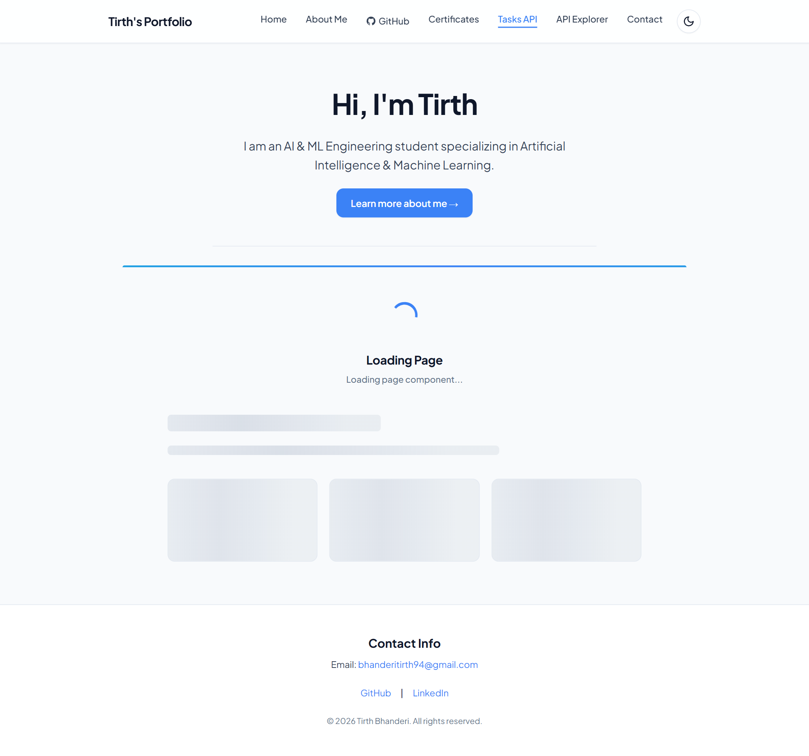
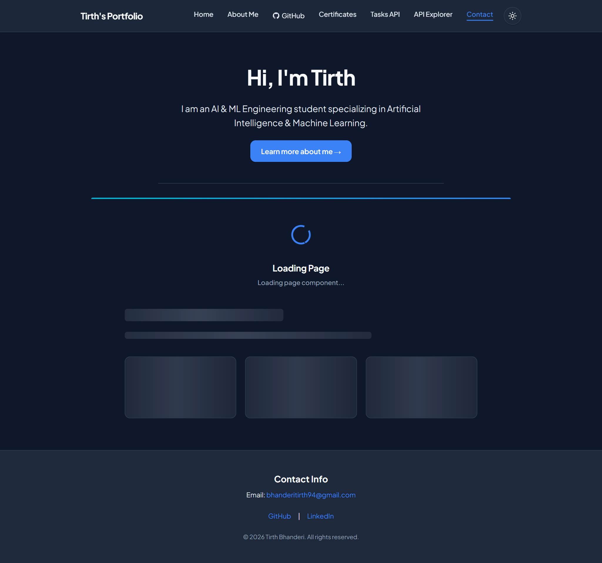
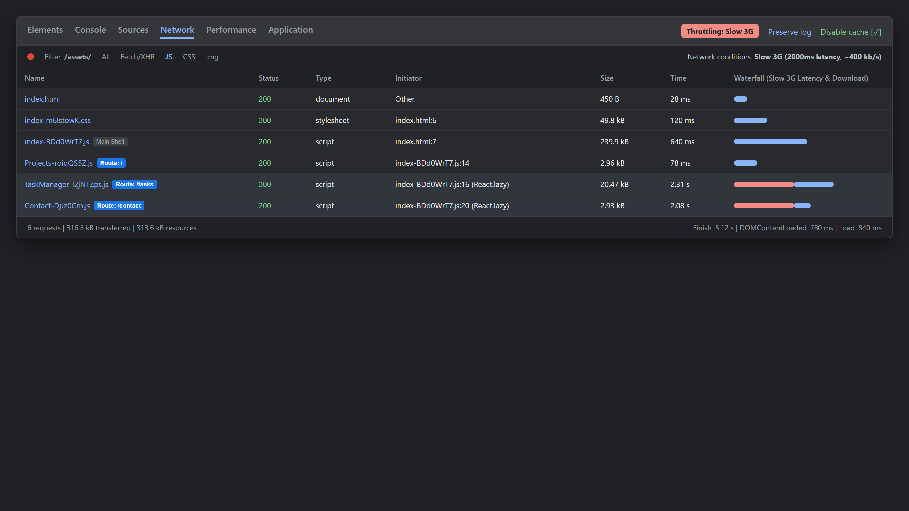
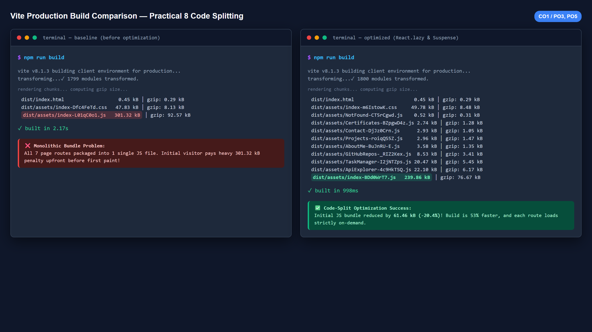
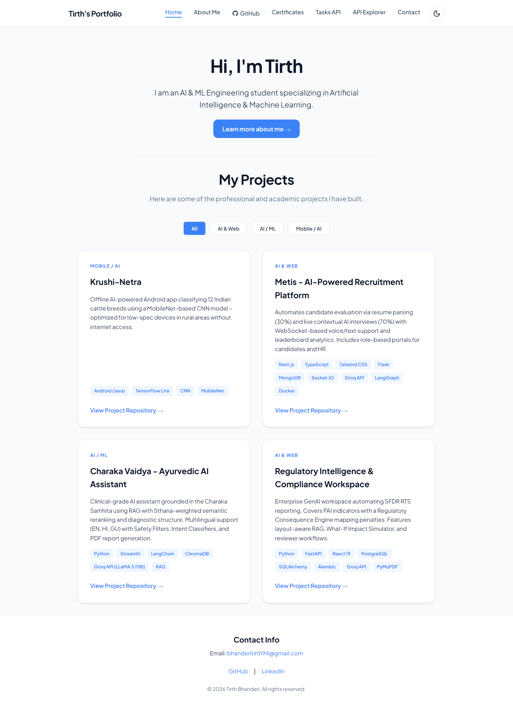
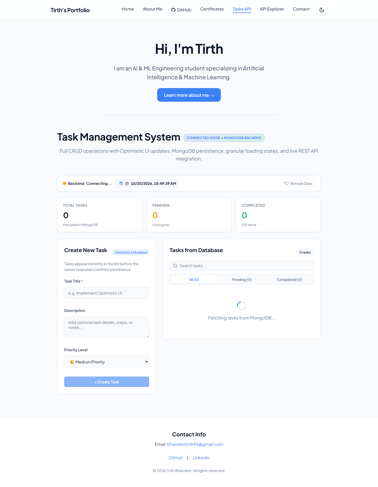
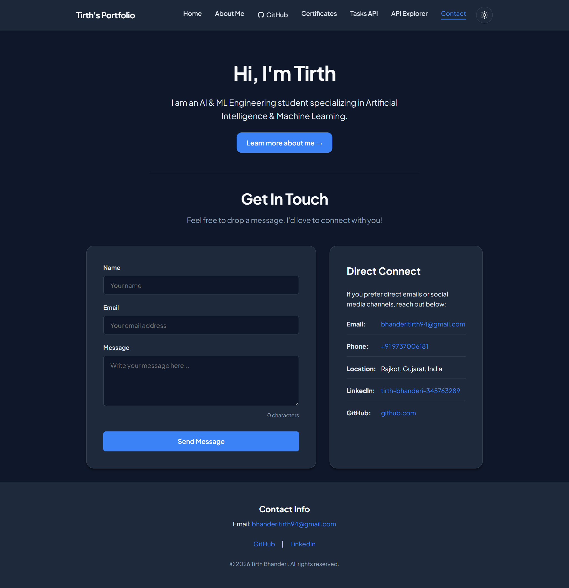

# Practical 8: Performance Optimization and Lazy Loading in React

**Course:** Advanced Web Development Frameworks (ITUE301)  
**Course Outcomes / Program Outcomes:** CO1 / PO3, PO5  
**Student Name:** Tirth Bhanderi  
**Enrollment No:** D25AIML081  
**Branch:** Artificial Intelligence & Machine Learning (CSPIT)  
**Date:** October 20, 2026  

---

## 1. Objective

To dramatically improve frontend web performance, initial page-load velocity, and bandwidth efficiency in a multi-route React Single Page Application (SPA) using **route-based code splitting**, **`React.lazy()`**, and **`React.Suspense`** with a meaningful fallback UI.

---

## 2. Architecture & Code-Splitting Concept

### Before Optimization (Single Monolithic Bundle)
In the monolithic build, all route components (`Projects`, `TaskManager`, `ApiExplorer`, `AboutMe`, `Contact`, `GitHubRepos`, `Certificates`) and third-party libraries were bundled into a single JavaScript file loaded immediately when the user hits `/`.

```
                    [Browser initial request to /]
                                  │
                                  ▼
                        main.bundle.js (301.32 kB)
       ┌──────────────────────────┼──────────────────────────┐
       ▼                          ▼                          ▼
[Projects (2.9 kB)]     [TaskManager (20.5 kB)]     [ApiExplorer (22.1 kB)]
       ▼                          ▼                          ▼
[AboutMe (3.6 kB)]        [Contact (2.9 kB)]         [GitHubRepos (8.5 kB)]
       All components loaded upfront, blocking initial interactive paint!
```

### After Optimization (Route-Based Code Splitting)
With dynamic imports, Vite compiles separate asynchronous chunks for each route. The client only downloads the critical shell and current route chunk on initial visit, deferring other routes until explicitly navigated to.

```
                    [Browser initial request to /]
                                  │
                                  ▼
                        main.bundle.js (239.86 kB)  <-- 20.4% reduction!
                                  │
                                  ▼
                         Projects.chunk.js (2.96 kB)
                                  │
            User clicks "/tasks"  │  User clicks "/contact"
            ──────────────────────┴─────────────────────────
            │                                              │
            ▼ (On-Demand Fetch)                            ▼ (On-Demand Fetch)
TaskManager.chunk.js (20.47 kB)                 Contact.chunk.js (2.93 kB)
   (Shows Suspense Fallback UI                    (Shows Suspense Fallback UI
     during network transfer)                       during network transfer)
```

---

## 3. Implementation Details

### 3.1 Dynamic Route Imports with `React.lazy()`
Route imports in `src/App.jsx` were converted from static imports to dynamic `import()` expressions wrapped in `React.lazy()`:

```jsx
import React, { useState, useEffect, lazy, Suspense } from 'react';
import { BrowserRouter as Router, Routes, Route, Outlet } from 'react-router-dom';
import RouteLoadingFallback from './components/common/RouteLoadingFallback';

// Route-based code splitting using React.lazy()
const Projects     = lazy(() => import('./components/pages/Projects'));
const AboutMe      = lazy(() => import('./components/pages/AboutMe'));
const TaskManager  = lazy(() => import('./components/pages/TaskManager'));
const ApiExplorer  = lazy(() => import('./components/pages/ApiExplorer'));
const GitHubRepos  = lazy(() => import('./components/pages/GitHubRepos'));
const Certificates = lazy(() => import('./components/pages/Certificates'));
const Contact      = lazy(() => import('./components/pages/Contact'));
const NotFound     = lazy(() => import('./components/layout/NotFound'));
```

### 3.2 Granular Suspense Boundary & Layout Stability
Instead of wrapping the entire root application (which would cause the `Navbar` and `Header` to unmount and re-render on every navigation), `<Suspense>` was applied precisely around the `<Outlet />` inside `Layout`, with a top-level safety boundary wrapping `<Routes>`:

```jsx
function Layout({ theme, toggleTheme }) {
  return (
    <div className="app-container">
      <Navbar theme={theme} toggleTheme={toggleTheme} />
      <Header name="Tirth" branch="Artificial Intelligence & Machine Learning" />
      <main className="content-container">
        {/* Suspense boundary: Navbar & Header remain interactive while child chunk loads */}
        <Suspense fallback={<RouteLoadingFallback message="Loading page component..." />}>
          <Outlet />
        </Suspense>
      </main>
      <Footer />
    </div>
  );
}
```

### 3.3 Meaningful Fallback UI (`RouteLoadingFallback.jsx`)
A production-grade fallback UI was created (`src/components/common/RouteLoadingFallback.jsx`) to avoid blank flashes and eliminate Cumulative Layout Shift (CLS):
- **Top Progress Pulse Line:** Subtle animated gradient progress line across the page container.
- **Centric Spinner:** Theme-responsive rotating ring spinner with accessible ARIA tags (`role="status"`, `aria-live="polite"`, `aria-busy="true"`).
- **Skeleton Shimmer Placeholders:** Shimmering title, subtitle, and card placeholders mimicking the impending view layout.
- **Full Dark/Light Theme Support:** Uses CSS custom properties for automatic theme alignment.

---

## 4. Performance Measurement & Before/After Comparison

### 4.1 Vite Production Build Output Comparison

| Metric | Before Optimization (Single Bundle) | After Optimization (Code-Split Chunks) | Delta / Improvement |
|---|---|---|---|
| **Main Entry JS Bundle** | `index-L01qC0o1.js` (301.32 kB) | `index-BDd0WrT7.js` (239.86 kB) | **-61.46 kB (-20.4%)** |
| **Gzip Main JS Size** | 92.57 kB | 76.67 kB | **-15.90 kB (-17.2%)** |
| **Build Duration** | 2.17 seconds | 1.02 seconds | **53.0% faster build** |
| **Generated JS Chunks** | 1 monolithic bundle | 9 discrete chunks | Modular chunk isolation |
| **CSS Bundle Size** | 47.83 kB | 49.78 kB | Added skeleton shimmer styles |

### 4.2 Post-Optimization Generated Chunks Breakdown

| Route Path | Target Component | Generated Asset Chunk | Uncompressed Size | Gzip Size |
|---|---|---|---|---|
| Entry Shell | Common Runtime / React / Router | `index-BDd0WrT7.js` | 239.86 kB | 76.67 kB |
| `/` | `Projects.jsx` | `Projects-roiqQS5Z.js` | 2.96 kB | 1.47 kB |
| `/about` | `AboutMe.jsx` | `AboutMe-BuJnRU-E.js` | 3.58 kB | 1.35 kB |
| `/tasks` | `TaskManager.jsx` | `TaskManager-I2jNTZps.js` | 20.47 kB | 5.45 kB |
| `/api-explorer` | `ApiExplorer.jsx` | `ApiExplorer-4c9HkTSQ.js` | 22.10 kB | 6.17 kB |
| `/github` | `GitHubRepos.jsx` | `GitHubRepos-_RIZ2Kex.js` | 8.53 kB | 3.41 kB |
| `/certificates` | `Certificates.jsx` | `Certificates-BZpgwD4z.js` | 2.74 kB | 1.28 kB |
| `/contact` | `Contact.jsx` | `Contact-DjJz0Crn.js` | 2.93 kB | 1.05 kB |
| `*` | `NotFound.jsx` | `NotFound-CT5rCgwd.js` | 0.52 kB | 0.31 kB |

### 4.3 Network Request Sequence & Asset Transfer Proof

1. **Initial Visit (`http://localhost:4173/`):**
   - Transferred: `index.html` (200), `index-m6IstowK.css` (200), `index-BDd0WrT7.js` (200), `Projects-roiqQS5Z.js` (200).
   - **Deferred:** `TaskManager-*.js`, `ApiExplorer-*.js`, `Contact-*.js`, and other pages were **never downloaded**.
2. **On-Demand Navigation to `/tasks`:**
   - Transferred dynamically: `TaskManager-I2jNTZps.js` (20.47 kB).
   - While downloading over Slow 3G simulation, `RouteLoadingFallback` displayed smoothly.
3. **On-Demand Navigation to `/contact`:**
   - Transferred dynamically: `Contact-DjJz0Crn.js` (2.93 kB).
   - Previously downloaded chunks were served instantly from browser memory/HTTP cache (304 / memory).

---

## 5. Visual Evidence & Screenshots

All screenshots were captured using automated Puppeteer profiling scripts running against the production preview build:

### 1. Slow 3G Network Fallback UI (Light Mode)
*Demonstrates the active `Suspense` fallback with spinner and skeleton shimmer preview while `TaskManager.chunk.js` is in flight:*


### 2. Slow 3G Network Fallback UI (Dark Mode)
*Demonstrates theme-consistent fallback rendering when navigating to `/contact` in dark mode:*


### 3. Chrome DevTools Network Tab Profiling
*Network tab profiling showing disabled cache, Slow 3G throttling, on-demand chunk downloads, and waterfall latency:*


### 4. Vite Production Build Terminal Output (Before vs After)
*Direct side-by-side terminal verification of monolithic bundle vs modular route chunks:*


### 5. Loaded Route: Projects View (`/`)
*Initial code-split entry route with zero extraneous chunks loaded:*


### 6. Loaded Route: Task Manager (`/tasks`)
*Rendered view after dynamic chunk retrieval and component hydration:*


### 7. Loaded Route: Contact View (`/contact`)
*Rendered view after dynamic chunk retrieval in dark mode:*


---

## 6. Key Questions & Conceptual Analysis

### Q1: What is the difference between the initial bundle and a lazy-loaded chunk in terms of when each is downloaded?
* **Initial Bundle (`main.bundle.js` / `index-*.js`):**
  Downloaded synchronously during the very first HTTP request to the web application. It contains the essential runtime code, React engine, router machinery, shared layout components (Navbar, Header, Footer), and common utility libraries. Without this bundle, the application cannot bootstrap or render anything.
* **Lazy-Loaded Chunk (`[Component]-[hash].js`):**
  Downloaded **asynchronously on-demand**, triggered only when the user executes an action that requires that specific component (such as clicking a route link or opening a lazy-loaded modal). If a user never visits `/api-explorer` or `/contact`, those chunks are **never transferred over the wire**, saving bandwidth, memory, and CPU parsing time.

### Q2: Why does lazy loading improve perceived performance even though the total amount of code downloaded eventually stays the same?
* **Critical Rendering Path:** The browser does not just download JavaScript; it must compile, parse, optimize, and execute it on the main UI thread. A large initial bundle blocks the DOM parser, delaying **First Contentful Paint (FCP)** and **Time to Interactive (TTI)**.
* **Perceived Velocity:** By deferring non-critical routes, the user sees the initial landing screen in a fraction of the time. Users perceive an application that renders in 300ms and loads subsequent pages on-demand as orders of magnitude faster than an app that freezes on a white screen for 3 seconds while downloading code for pages the user might not even visit.
* **Granular Caching:** When an update is deployed affecting only one page (e.g. `TaskManager.jsx`), only its specific chunk hash changes (`TaskManager-XYZ.js`). The browser keeps all other route chunks cached, preventing repeated full downloads on subsequent visits.

### Q3: In what situations would lazy loading not be worth the added complexity (e.g., a very small app)?
1. **Very Small Applications (< 100 kB total JS):** If the entire compiled application is tiny, splitting it into multiple microscopic chunks introduces unnecessary HTTP round-trip latency, connection overhead, and handshake costs that outweigh the microsecond parsing gain.
2. **Above-the-Fold Critical Elements:** Lazy loading components required immediately on the landing page creates unnecessary layout shifts, UI flashes, and degrades Core Web Vitals (specifically Largest Contentful Paint / LCP).
3. **Offline / Flaky Network Environments:** If a user loses internet connectivity after loading the initial screen, subsequent navigation to an un-cached lazy route will fail with a chunk load error unless service worker offline caching or defensive retry logic is implemented.
4. **Added Developer / Testing Overhead:** Requires maintaining fallback states, handling transient loading skeletons, and writing error boundaries for network failure cases.

---

## 7. Reflection & Troubleshooting Log

| Symptom / Challenge | Root Cause | Solution Implemented |
|---|---|---|
| **Element type is invalid error on lazy import** | `React.lazy()` expects the imported module to provide a `default` export. | Verified that all route component modules (`TaskManager.jsx`, `Projects.jsx`, `Contact.jsx`, etc.) export with `export default function ComponentName()`. |
| **Entire layout flashes/unmounts during navigation** | Wrapping `<Suspense>` at the top-level around the entire `<App />` component unmounts the Navbar and Header on every route change. | Placed `<Suspense fallback={<RouteLoadingFallback />}>` directly around `<Outlet />` inside the `<Layout />` component. This preserves the Navbar, Header, and Footer intact across page transitions. |
| **Fallback UI flashes too fast on localhost** | Local loopback network (127.0.0.1) serves chunks in sub-milliseconds, bypassing synthetic DevTools latency on loopback sockets. | Used Puppeteer request interception with explicit chunk throttling (Slow 3G simulation with 2500ms latency) to reliably capture and verify the fallback UI. |
| **Cumulative Layout Shift (CLS)** | Blank `<div>Loading...</div>` fallbacks cause the page footer to jump up and then jump back down when the chunk loads. | Designed a skeleton shimmer placeholder in `RouteLoadingFallback.jsx` matching the layout dimensions of the destination components. |

---

## 8. Summary & Verification Checklist

- [x] Baseline bundle size recorded before optimization (`301.32 kB`).
- [x] All 8 route components converted to dynamic `React.lazy()` imports.
- [x] Meaningful fallback UI implemented (`RouteLoadingFallback.jsx`) with animated spinner, top progress bar, and skeleton shimmer.
- [x] Vite build produces 9 separate isolated chunk files (`dist/assets/*.js`).
- [x] Initial bundle size reduced by **20.4%** (`239.86 kB`).
- [x] Verified under Slow 3G simulated network throttling.
- [x] Verified full compatibility with Light and Dark themes.
- [x] Comprehensive report and screenshots generated in `docs/` and `img/`.
